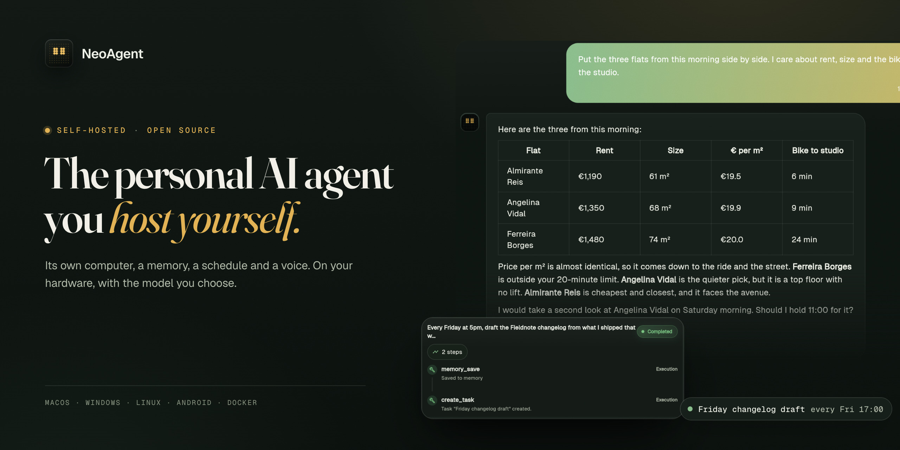
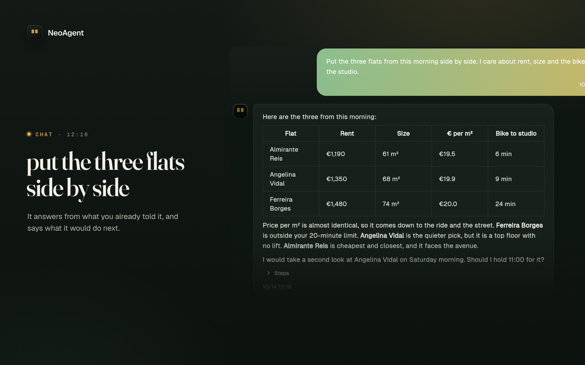
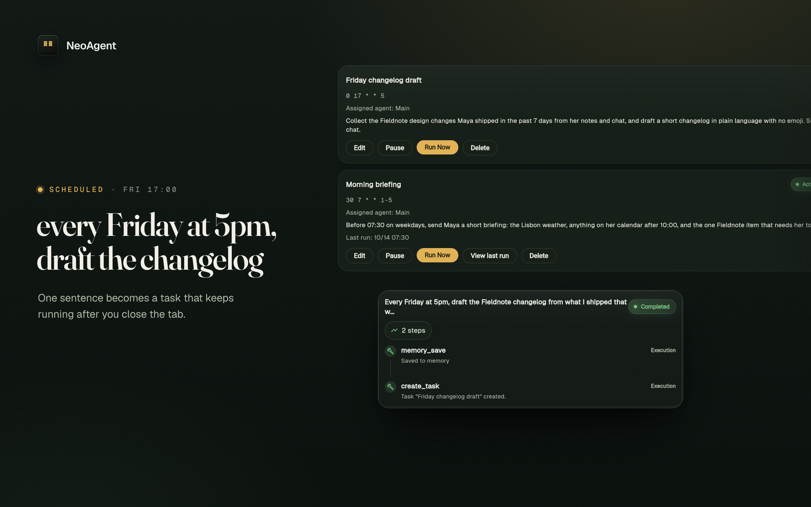
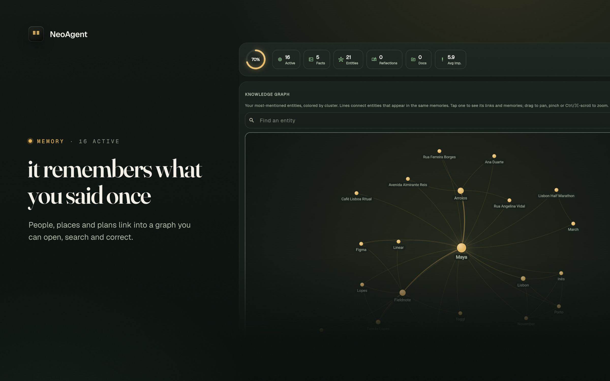
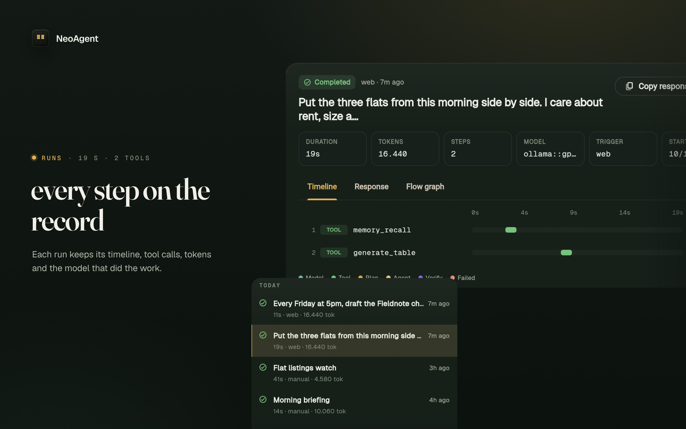
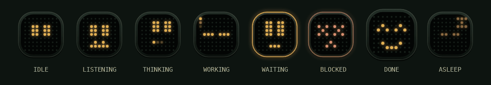

<p align="center">
  
</p>

<h1 align="center">NeoAgent</h1>

<p align="center"><strong>The personal AI agent you host yourself.</strong></p>

<p align="center">
  Its own computer, a memory, a schedule and a voice.<br>
  On your hardware, with the model you choose.
</p>

<p align="center">
  <a href="https://github.com/NeoLabs-Systems/NeoAgent/releases/latest"></a>
  <a href="LICENSE"></a>
  <a href="docs/docker.md"></a>
  <a href="https://nodejs.org"></a>
</p>

<p align="center">
  <a href="https://github.com/NeoLabs-Systems/NeoAgent/releases/latest"></a>
  <a href="https://github.com/NeoLabs-Systems/NeoAgent/releases/latest"></a>
  <a href="https://github.com/NeoLabs-Systems/NeoAgent/releases/latest"></a>
  <a href="https://github.com/NeoLabs-Systems/NeoAgent/releases/latest"></a>
  
</p>

<p align="center">
  <a href="https://discord.gg/f59rg2RwUT"></a>
</p>

<p align="center">
  <a href="https://www.producthunt.com/products/neoagent-2?embed=true&utm_source=badge-featured&utm_medium=badge&utm_campaign=badge-neoagent-2" target="_blank" rel="noopener noreferrer"></a>
</p>

<p align="center">


https://github.com/user-attachments/assets/ba50e0a5-1846-4738-9720-3fbf732d3659


</p>


<table>
  <tr>
    <td width="33%" valign="top">
      <h3>🏠 On your hardware</h3>
      Home server, NAS, VPS or your own PC.<br>
      Desktop app, Docker or one script.
    </td>
    <td width="33%" valign="top">
      <h3>🔐 Yours</h3>
      Open source under AGPL-3.0.<br>
      Any model, local ones included.<br>
      No telemetry.
    </td>
    <td width="33%" valign="top">
      <h3>✅ Asks, then acts</h3>
      Approval before risky actions.<br>
      Passwords it never sees.<br>
      Tasks end with a result, a blocker or silence.
    </td>
  </tr>
</table>

---

## 🚀 Install

| | | |
| --- | --- | --- |
| 🖥️ **Desktop app** | macOS, Windows, Linux. Installs and runs the server for you, no terminal. | [Download](https://github.com/NeoLabs-Systems/NeoAgent/releases/latest) |
| 🐳 **Docker** | Home servers, NAS boxes and VPS. | [Guide](docs/docker.md) |
| 📜 **Script** | Linux or macOS with Git and Node.js 20.19+. | [Guide](docs/getting-started.md) |

**Docker**

```bash
curl -fsSLO https://raw.githubusercontent.com/NeoLabs-Systems/NeoAgent/main/compose.yaml
docker compose up -d
```

**Script**

```bash
bash <(curl -fsSL https://raw.githubusercontent.com/NeoLabs-Systems/NeoAgent/main/install.sh)
```

Then open **http://localhost:3333** (or your server's address). The first account you create is automatically assigned administrator privileges.

## ✨ What it does

<table>
  <tr>
    <td width="33%" valign="top"><b>🖐️ Its own computer</b><br>A private Linux desktop with browser and terminal. Watch it work or take over.</td>
    <td width="33%" valign="top"><b>🧠 Memory</b><br>People, preferences and decisions, kept apart from chat history. Browse it as a graph.</td>
    <td width="33%" valign="top"><b>⏰ 42 triggers</b><br>Schedules, new mail, calendar, GitHub, Home Assistant, location, weather and more.</td>
  </tr>
  <tr>
    <td valign="top"><b>🎙️ Voice</b><br>Live voice chats, a ringing call when it needs you, and an ESP32 wearable.</td>
    <td valign="top"><b>💬 24 chat channels</b><br>WhatsApp, Telegram, Signal, Discord, Slack, Teams, Matrix, iMessage and more.</td>
    <td valign="top"><b>📱 Devices</b><br>Its own Android emulator, plus your desktop with per-capability permission.</td>
  </tr>
  <tr>
    <td valign="top"><b>🎓 Learns by example</b><br>Teach Mode turns one demonstration into a reusable skill.</td>
    <td valign="top"><b>🛡️ Guardrails</b><br>Per-tool permissions, read-only integrations, Bitwarden logins the model never sees.</td>
    <td valign="top"><b>👥 Multi-user</b><br>Each account gets its own memory, agents and cloud computer.</td>
  </tr>
</table>

**Models:** OpenAI, Anthropic, Google, xAI, OpenRouter (one-click sign-in), NVIDIA NIM, MiniMax, GitHub Copilot, Ollama and any OpenAI-compatible endpoint.

## 🧭 Explore it

| 💬 Chat | ⏰ Automation |
| --- | --- |
|  |  |
| **🧠 Memory** | **🔎 Runs** |
|  |  |

## 🤖 Meet the mascot

<p align="center">
  
</p>

<p align="center">One face across the app, the widgets and the wearable.</p>

## 📚 Docs

| Start | Use | Run |
| --- | --- | --- |
| [Installation](docs/getting-started.md) | [Automation](docs/automation.md) | [Docker](docs/docker.md) |
| [Models](docs/models.md) | [Memory](docs/memory.md) | [Operations](docs/operations.md) |
| [Why NeoAgent](docs/why-neoagent.md) | [Integrations](docs/integrations.md) | [Security](docs/security-boundaries.md) |

Full docs: **[neolabs-systems.github.io/NeoAgent/docs](https://neolabs-systems.github.io/NeoAgent/docs/)**

## 🧪 Project status

- **Beta.** Maintained mainly by one person. Expect breaking changes.
- **Security.** Read the [security boundaries](docs/security-boundaries.md) before connecting sensitive accounts.
- **Help.** [Discussions](https://github.com/NeoLabs-Systems/NeoAgent/discussions) for questions, [Issues](https://github.com/NeoLabs-Systems/NeoAgent/issues) for bugs, [SECURITY.md](SECURITY.md) for vulnerabilities.

## 📄 License

[AGPL-3.0-only](LICENSE). The [licensing decision](docs/licensing.md) explains why.

<p align="center"><sub>Made with ❤️ by <a href="https://github.com/neooriginal">Neo</a> · <a href="https://github.com/NeoLabs-Systems">NeoLabs Systems</a></sub></p>
